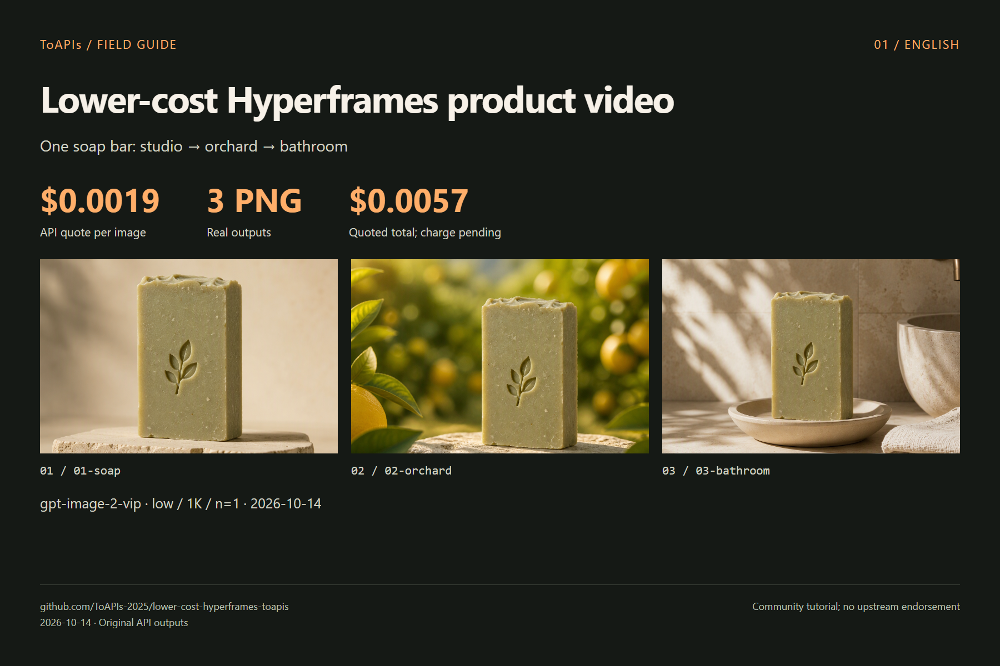

# Lower-cost Hyperframes product video

<!-- TOAPIS-MODEL-COST-UPDATE-20261016 -->
## Tested model types, presets and costs

Updated October 16, 2026. These are tested historical presets/prices; this addition does not relabel the original batch below.

| Model (API ID) | Type | Tested preset | Unit quote | Confirmed unit charge | Count |
|---|---|---|---:|---:|---:|
| gpt-image-2(VIP) (`gpt-image-2-vip`) | Image | low / 1K / n=1 | $0.0019/image | $0.0019 | 3 |

Confirmed original image/video example subtotal: **$0.0057**.

Image API calls and a 12-second local MP4 render validated; local rendering is not a video-model call.

Local rendering makes no video-model call. Dividing image spend by 12 seconds would not be a video API rate.

gpt-image-2(VIP), **from $0.0019/image**; the tested low/1K preset here is **$0.0019/image**. Different models, qualities and resolutions do not imply equivalent results.
<!-- /TOAPIS-MODEL-COST-UPDATE-20261016 -->

[中文](README_zh-CN.md)

ToAPIs `gpt-image-2-vip / low / 1K / n=1` for Hyperframes workflows. 3 image-2(vip) images: **$0.0057 actually charged**.

Three ToAPIs product images → Hyperframes HTML timeline → local MP4 rendering. Image API calls are charged; local rendering does not call a video model.

> Community tutorial; no upstream endorsement. “Lower-cost” describes this API tier, not total software or all-model costs.

## Demo



| Case | Original image | Output pixels |
|---|---|---|
| 01-soap | [PNG](assets/01-soap.png) | 1024 × 1024 |
| 02-orchard | [PNG](assets/02-orchard.png) | 1024 × 1024 |
| 03-bathroom | [PNG](assets/03-bathroom.png) | 1024 × 1024 |

### Video demo



[MP4](assets/product-12s.mp4) · [HTML timeline](demo/index.html)

3 scenes × 4 seconds; 1280×720, 24 fps, no audio. Local Hyperframes rendering, not a ToAPIs video generation call.

## Model price and this demo’s cost

| Model | Configuration | API unit quote |
|---|---|---|
| `gpt-image-2-vip` | `low / 1K / n=1` | **$0.0019** |

3 image-2(vip) images: **$0.0057 actually charged**。

[API pricing snapshot](evidence/pricing.json) · [Cost record](evidence/costs.json) · [Original requests](evidence/runs.json)

Quote checked on 2026-10-14. Other tiers, resolutions, models, agents and machine costs are excluded.

[ToAPIs model landing page](https://go2v.toapis.com/1014_hyperframes_lowercost_gh_en)

## Reproduce

Set `TOAPIS_API_KEY` privately in your local environment. Keep it out of source code and chats. Use `TOAPIS_BASE_URL=https://toapis.cn` or `https://toapis.com`.


```bash
# Inspect without paid calls
python scripts/run_demo.py
# Generate the original cases (charged; exact quote checked first)
python scripts/run_demo.py --live --output results
```

The generic script is an external asset runner. Original PPT Master CLI runs are separately identified in the evidence.

```bash
cd demo
npm install
npx hyperframes lint
npx hyperframes check
npx hyperframes render --fps 24 --workers 1 --quality looks --output ../assets/product-12s.mp4
```

Requires Node.js 22+, FFmpeg and Chromium. First copy the 3 result PNGs to matching assets filenames. Full steps: [GUIDE](GUIDE.md).

## API mapping

```text
Authorization: Bearer TOAPIS_API_KEY
POST /v1/uploads/images             # reference PNG -> HTTPS URL
POST /v1/images/generations         # model,prompt,size,resolution,quality,n,reference_images
GET  /v1/images/generations/{id}    # poll the SAME task
completed -> result.data[0].url -> download PNG without the API key
```

Generation POST is never automatically retried. Preserve .toapis-state or results/private-state to resume the same task. Reference editing is not masked inpainting. Masks, transparency, audio and cloud video were not tested.

## Upstream and licenses

[heygen-com/hyperframes](https://github.com/heygen-com/hyperframes) · [pinned `d77b03c2`](https://github.com/heygen-com/hyperframes/tree/d77b03c24cd2e7c855c602fa8c4546f8076a1dca)

[Third-party notices](THIRD_PARTY_NOTICES.md)
