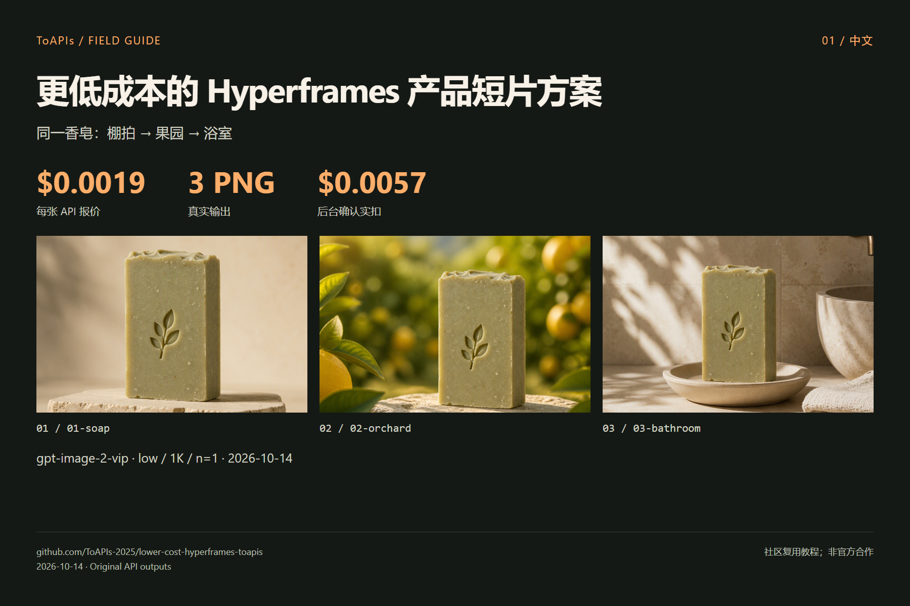

# 更低成本的 Hyperframes 产品短片方案

[English](README.md)

以 ToAPIs `gpt-image-2-vip / low / 1K / n=1` 复用 Hyperframes 场景。3张 image-2(vip) 生图实扣 **$0.0057**。

ToAPIs 生成 3 张产品素材 → Hyperframes HTML 时间线 → 本地 MP4 渲染；图片 API 有费用，本地渲染不调用视频模型。

> 社区教程；未获上游背书。“更低成本”描述本次 API 档位，不表示整个软件或全部模型总成本更低。

## 演示



| 案例 | 原图 | 输出像素 |
|---|---|---|
| 01-soap | [PNG](assets/01-soap.png) | 1024 × 1024 |
| 02-orchard | [PNG](assets/02-orchard.png) | 1024 × 1024 |
| 03-bathroom | [PNG](assets/03-bathroom.png) | 1024 × 1024 |

### 视频演示


[MP4](assets/product-12s.mp4) · [HTML timeline](demo/index.html)

3 个场景 × 4 秒，1280×720、24 fps、无音轨；本地 Hyperframes 渲染，不是 ToAPIs 视频生成调用。

## 对应模型价格与本次花费

| Model | 配置 | API 单张报价 |
|---|---|---|
| `gpt-image-2-vip` | `low / 1K / n=1` | **$0.0019** |

3张 image-2(vip) 生图实扣 **$0.0057**。

[API pricing snapshot](evidence/pricing.json) · [Cost record](evidence/costs.json) · [Original requests](evidence/runs.json)

报价核查于 2026-10-14；不含其他画质、分辨率、模型、Agent 或机器成本。

[ToAPIs 模型落地页](https://go2v.toapis.com/1014_hyperframes_lowercost_gh_cn)

## 复现步骤

本机私有环境配置 `TOAPIS_API_KEY`，不要写进源码或聊天。`TOAPIS_BASE_URL=https://toapis.cn`（海外可用 `https://toapis.com`）。


```bash
# Inspect without paid calls
python scripts/run_demo.py
# Generate the original cases (charged; exact quote checked first)
python scripts/run_demo.py --live --output results
```

本通用脚本是独立 API 素材脚本；PPT Master 的原 CLI 实测记录单独标注在证据中。

```bash
cd demo
npm install
npx hyperframes lint
npx hyperframes check
npx hyperframes render --fps 24 --workers 1 --quality looks --output ../assets/product-12s.mp4
```

需 Node.js 22+、FFmpeg 与 Chromium；先把 results 的 3 张 PNG 复制到 assets 对应文件名。完整复用步骤见 [GUIDE](GUIDE_zh-CN.md)。

## 接口映射

```text
Authorization: Bearer TOAPIS_API_KEY
POST /v1/uploads/images             # reference PNG -> HTTPS URL
POST /v1/images/generations         # model,prompt,size,resolution,quality,n,reference_images
GET  /v1/images/generations/{id}    # poll the SAME task
completed -> result.data[0].url -> download PNG without the API key
```

生成 POST 不自动重试；轮询超时保留 `.toapis-state` 或 results/private-state 的任务 ID，重新执行同一用例会继续查询。参考改图不等于 mask 局部重绘；本轮没有测试 mask、透明背景、音频或云端视频。

## 上游与许可证

[heygen-com/hyperframes](https://github.com/heygen-com/hyperframes) · [pinned `d77b03c2`](https://github.com/heygen-com/hyperframes/tree/d77b03c24cd2e7c855c602fa8c4546f8076a1dca)

[Third-party notices](THIRD_PARTY_NOTICES.md)
